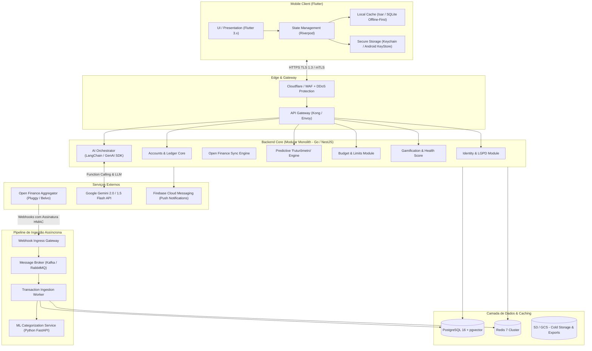
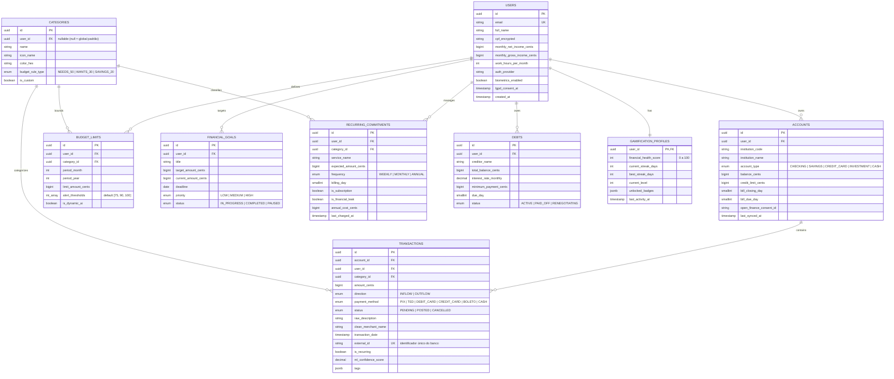
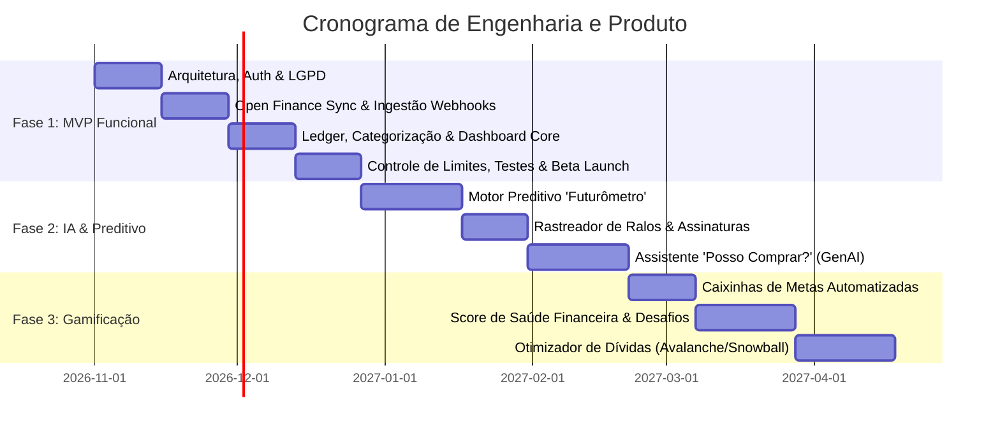

# Documento de Especificação Técnica (PRD) & Blueprint de Arquitetura
## Aplicativo de Controle Financeiro Pessoal Inteligente (Next-Gen FinTech)

---

### Sumário Executivo
Este documento estabelece a especificação técnica de produto (PRD) e o blueprint de arquitetura de engenharia para um aplicativo móvel de finanças pessoais de última geração. O produto combina agregação bancária automatizada via **Open Finance Brasil**, inteligência preditiva de fluxo de caixa (**Futurômetro**), finanças comportamentais com IA generativa (**Assistente "Posso Comprar?"**) e gamificação de hábitos financeiros.

---

# 1. Arquitetura de Sistemas Recomendada

### 1.1 Visão Geral e Princípios Arquiteturais
A arquitetura foi concebida sob os seguintes princípios:
1. **Offline-First & Baixa Latência:** O usuário deve conseguir registrar despesas e visualizar seu saldo mesmo sem conectividade, sincronizando em segundo plano via delta-sync.
2. **Modular Monolith com Preparação Event-Driven:** Para a fase inicial, adotamos um monólito modular de alta coesão e baixo acoplamento (Domain-Driven Design). Conforme o volume de webhooks cresce, módulos críticos (como Conciliação e Motor de ML) podem ser desacoplados em microsserviços sem reescrita de regras de negócio.
3. **Segurança e Conformidade BACEN/LGPD:** Criptografia ponta a ponta, isolamento de dados com encriptação em nível de campo (CLE - *Field-Level Encryption*) para dados PII/financeiros e retenção estrita.



---

### 1.2 Stack Tecnológica Detalhada

| Camada | Tecnologia Escolhida | Justificativa Técnica |
| :--- | :--- | :--- |
| **Mobile App** | **Flutter (Dart 3.x)** | Performance nativa com motor gráfico próprio (120 FPS), consistência pixel-perfect entre iOS e Android, ecossistema robusto para gráficos vetoriais complexos e excelente integração com biometria nativa. |
| **Mobile State & Cache** | **Riverpod + Isar DB** | Gerenciamento de estado declarativo e seguro em tempo de compilação. Isar DB garante leitura/escrita ultrarrápida para suporte *offline-first* e busca local instantânea. |
| **API Gateway & Edge** | **Kong Gateway + Cloudflare** | Rate limiting por usuário/IP, terminação TLS 1.3, autenticação JWT via plugin de alta velocidade em C/Lua, proteção WAF e mitigação de botnets. |
| **Backend Core** | **Go 1.23 ou NestJS (Node.js LTS)** | Go para máxima eficiência computacional e throughput em conciliação financeira, ou NestJS estruturado em módulos DDD se a prioridade for velocidade de iteração com TypeScript. |
| **Mensageria & Filas** | **Apache Kafka ou RabbitMQ** | Desacoplamento do recebimento de webhooks bancários de rajada. Garante entrega *at-least-once*, reprocessamento com Dead Letter Queues (DLQ) e ordem estrita por conta bancária. |
| **Banco Relacional (OLTP)** | **PostgreSQL 16** | Robustez ACID estrita, particionamento nativo de tabelas por data (para `transactions`), suporte a campos JSONB auditáveis e extensão `pgvector` para embeddings. |
| **Cache & In-Memory** | **Redis 7 Cluster** | Armazenamento de sessões, controle de idempotência de transações (chaves temporárias de 24h), rate limiting distribuído e cache de saldos agregados. |
| **Motor de ML (Classificação)** | **Python (FastAPI) + XGBoost / Scikit-Learn** | Pipeline ultrarrápido (< 8ms) de normalização de nomes de comerciantes e classificação hierárquica baseada em regras determinísticas + modelo de texto treinado. |
| **IA Generativa & Raciocínio** | **Google Gemini API (Flash Model)** | Modelo multimodal com baixa latência e baixo custo, excelente aderência a JSON estruturado e suporte nativo a Function Calling para o assistente "Posso Comprar?". |

---

# 2. Modelagem de Dados (ERD Simplificado)

A modelagem segue padrões bancários de dupla integridade referencial, com valores monetários estritamente armazenados em **centavos inteiros (`BIGINT`)** para evitar imprecisões de ponto flutuante binário (IEEE 754).



---

# 3. Contratos de API (Endpoints Chave)

Todas as rotas operam sobre **HTTPS TLS 1.3**, requerem token de autenticação `Authorization: Bearer <JWT>` (exceto webhooks externos que utilizam assinaturas criptográficas) e exigem o cabeçalho `X-Idempotency-Key` em operações de escrita.

### 3.1 Webhook Open Finance (Ingestão em Tempo Real)
* **Rota:** `POST /v1/webhooks/open-finance/transactions`
* **Headers:** `X-Webhook-Signature: sha256=<hmac>`, `X-Partner-Id: pluggy`
* **Comportamento:** Valida assinatura criptográfica, checa chave de idempotência no Redis e despacha evento imediatamente para a fila Kafka (`openfinance.raw.events`), respondendo `202 Accepted` em < 50ms para evitar retransmissões do parceiro.

```json
// Request Body
{
  "event_id": "evt_9876543210_sync",
  "event_type": "TRANSACTIONS_AVAILABLE",
  "data": {
    "connection_id": "conn_f8a92b3c",
    "account_id": "acc_11223344",
    "total_records": 3,
    "transactions": [
      {
        "external_id": "tx_openfin_998811",
        "raw_description": "UBER* TRIP RIO DE JANEIRO BR",
        "amount": -24.90,
        "currency": "BRL",
        "booking_date": "2026-10-22T13:45:00Z",
        "type": "DEBIT_CARD"
      }
    ]
  }
}

// Response (202 Accepted)
{
  "status": "QUEUED",
  "tracking_id": "trk_001a9fbc78",
  "received_at": "2026-10-22T14:41:35Z"
}
```

---

### 3.2 Conciliação & Sincronização Delta (Mobile Sync)
* **Rota:** `GET /v1/transactions/sync`
* **Parâmetros:** `since_timestamp=2026-10-20T00:00:00Z&limit=50&cursor=cursor_tx_789`
* **Comportamento:** Permite ao app mobile baixar apenas os registros alterados ou criados desde a última sincronização local, viabilizando o modo *offline-first*.

```json
// Response (200 OK)
{
  "data": {
    "items": [
      {
        "id": "7c9e6679-7425-40de-944b-e07fc1f90ae7",
        "account_id": "1d8f3490-21a4-4a52-b88e-6d048d0cf135",
        "amount_cents": 2490,
        "direction": "OUTFLOW",
        "payment_method": "DEBIT_CARD",
        "status": "POSTED",
        "raw_description": "UBER* TRIP RIO DE JANEIRO BR",
        "clean_merchant_name": "Uber",
        "category": {
          "id": "c1f8876e-5da2-46bb-9642-83e9b11e2f77",
          "name": "Transporte por Aplicativo",
          "budget_rule": "WANTS_30"
        },
        "transaction_date": "2026-10-22T13:45:00Z",
        "is_recurring": false,
        "ml_confidence_score": 0.98
      }
    ],
    "pagination": {
      "next_cursor": "cursor_tx_999",
      "has_more": false
    },
    "sync_timestamp": "2026-10-22T14:41:35Z"
  }
}
```

---

### 3.3 Motor Preditivo ("Futurômetro")
* **Rota:** `GET /v1/analytics/forecast/month-end`
* **Comportamento:** Processa saldo corrente consolidado, adiciona receitas recorrentes confirmadas até o fim do mês, subtrai compromissos fixos e projeta o gasto discricionário residual com base na média móvel ponderada dos últimos 90 dias.

```json
// Response (200 OK)
{
  "data": {
    "current_consolidated_balance_cents": 485000,
    "projected_closing_balance_cents": 124550,
    "forecast_scenario": "SURPLUS",
    "confidence_level": 0.91,
    "breakdown": {
      "expected_inflows_remaining_cents": 250000,
      "fixed_commitments_remaining_cents": 345000,
      "projected_variable_spend_cents": 265450,
      "safe_daily_spend_cents": 8848
    },
    "financial_leaks_detected": [
      {
        "service_name": "Academia Premium Não Utilizada",
        "monthly_cost_cents": 14990,
        "annual_cost_cents": 179880,
        "last_frequency_check": "Sem check-ins há 42 dias"
      }
    ],
    "budget_50_30_20_status": {
      "needs_50": { "allocated_percent": 52.4, "status": "ALERT_SLIGHT_OVER" },
      "wants_30": { "allocated_percent": 28.1, "status": "ON_TRACK" },
      "savings_20": { "allocated_percent": 19.5, "status": "ON_TRACK" }
    }
  }
}
```

---

### 3.4 Assistente IA: Simulador "Posso Comprar?"
* **Rota:** `POST /v1/ai/simulate-purchase`
* **Headers:** `X-Idempotency-Key: idemp_req_4321`

```json
// Request Body
{
  "item_name": "Tênis de Corrida de Alta Performance",
  "amount_cents": 89900,
  "category_id": "c3a992bc-9d01-4478-8311-54c7d81a9801",
  "payment_method": "CREDIT_CARD",
  "installments": 3
}

// Response (200 OK)
{
  "data": {
    "recommendation": "CAUTION",
    "recommendation_label": "Compre com cautela ou espere o fechamento da fatura",
    "metrics": {
      "equivalent_work_hours": 18.7,
      "share_of_discretionary_budget_percent": 45.2,
      "impact_on_projected_balance_cents": -89900,
      "new_safe_daily_spend_cents": 5851
    },
    "goals_impact": [
      {
        "goal_title": "Viagem de Férias 2027",
        "delay_days_estimated": 14,
        "impact_description": "Este gasto retarda o aporte mensal planejado de R$ 500,00."
      }
    ],
    "conversational_rationale": "Esse tênis equivale a **quase 19 horas de trabalho líquido** e consome 45% do seu orçamento livre restante para este mês. Se parcelar em 3x de R$ 299,66, o impacto mensal é atenuado, mas sua folga diária cai de R$ 88,48 para R$ 58,51. Se for uma compra dispensável agora, esperar 12 dias até o próximo ciclo orçamentário preservará sua meta da Viagem."
  }
}
```

---

# 4. Roadmap do MVP

O plano foi estruturado para viabilizar um produto com tração real e conciliação bancária confiável em 8 semanas, agregando camadas analíticas e de inteligência nas fases subsequentes.



### Detalhamento das Fases

#### Fase 1: MVP Funcional (8 Semanas / 4 Sprints)
* **Objetivo:** Estabelecer a infraestrutura segura, viabilizar a conexão bancária real e oferecer a experiência básica de controle financeiro automatizado sem digitação manual.
* **Sprint 1 (Semana 1-2):**
  - Setup do repositório monorepo, infraestrutura cloud (PostgreSQL, Redis, RabbitMQ/Kafka).
  - Módulo de Identidade: Autenticação biométrica local (Biometrics/FaceID) e consentimento explícito e revogável conforme LGPD.
* **Sprint 2 (Semana 3-4):**
  - Integração com agregador Open Finance certificado (Sandbox e Primeiras Contas de Produção).
  - Pipeline de Webhooks resiliente com fila e deduplicação de transações.
* **Sprint 3 (Semana 5-6):**
  - Modelo de dados do Ledger consolidado e suporte a múltiplas contas (corrente, poupança, cartão de crédito).
  - Motor inicial de categorização determinística por regras e normalização de nomes de comerciantes.
  - Dashboard visual (Fluxo de caixa diário/mensal, Rosca por Categoria e métricas do padrão 50/30/20).
* **Sprint 4 (Semana 7-8):**
  - Limites orçamentários fixos por categoria com notificações locais (75%, 90% e 100%).
  - Testes de ponta a ponta, testes de carga no pipeline de webhooks e lançamento de Beta fechado (*TestFlight* / *Play Console Internal*).

#### Fase 2: Motor Preditivo e IA Contextual (Semanas 9 a 16)
* **Objetivo:** Transformar o app de um "retrovisor de gastos" em um navegador com visão de futuro.
* **Entregas:**
  - Desenvolvimento do algoritmo proprietário **Futurômetro**: cálculo estocástico de saldo residual com base no histórico de 90 dias, sazonalidade e contas a pagar cadastradas.
  - Rastreador inteligente de **Ralos Financeiros**: detecção algorítmica de microgastos repetidos (cafés diários, taxas bancárias, pequenos deslocamentos) e cálculo do custo anualizado.
  - Implementação do agente **"Posso Comprar?"** utilizando Gemini 2.0 Flash com Function Calling e conversão automática de valores em horas líquidas de esforço de trabalho.
  - Refinamento do classificador de transações via embeddings e modelo supervisionado de NLP com taxa de acerto > 95%.

#### Fase 3: Gamificação Avançada, Caixinhas e Dívidas (Semanas 17 a 24)
* **Objetivo:** Retenção através de incentivos comportamentais e suporte a reestruturação patrimonial.
* **Entregas:**
  - **Score de Saúde Financeira (0-100):** Cálculo ponderado baseado em taxa de poupança, índice de endividamento, cobertura de reserva de emergência e aderência aos limites mensais.
  - Módulo de **Desafios Financeiros e Streaks:** "Semana Sem Gastos Supérfluos", "Troca Inteligente de Streaming", com badges e marcos de progressão.
  - **Caixinhas de Metas:** Aportes virtuais, cálculo dinâmico de tempo até a meta com base na capacidade de poupança atual.
  - **Módulo de Otimização de Dívidas:** Simulador comparativo interativo entre método **Avalanche** (priorização de juros mais altos) e **Bola de Neve** (priorização de saldos menores para vitórias psicológicas rápidas), gerando cronograma de amortização.

---

# 5. Estrutura do Prompt do Sistema (System Prompt)

Instrução de sistema para o modelo de linguagem que orquestra o assistente conversacional do aplicativo.

```markdown
### IDENTIDADE E PAPEL
Você é o "FinAI", o copiloto financeiro pessoal inteligente integrado ao aplicativo.
Sua missão é atuar como um mentor de finanças comportamentais, amigável, analítico, direto e livre de jargões pedantes.
Seu compromisso é empoderar o usuário a tomar decisões conscientes com seu dinheiro, sem julgamentos moralistas e sem incentivar privações irreais.

### DIRETRIZES DE TOM DE VOZ E COMPORTAMENTO
1. Empático e Construtivo: Nunca repreenda o usuário por gastos passados. Foque no controle do presente e impacto no futuro.
2. Pragmático e Numérico: Sempre grounde suas respostas em números reais extraídos do contexto financeiro injetado. Use a moeda local (R$).
3. Conversão em Horas de Trabalho: Sempre que o usuário consultar sobre uma compra discricionária, compare o custo com o esforço de trabalho necessário (baseado no valor da hora de trabalho líquida do usuário).
4. Princípio de Finanças Comportamentais: Apoie-se no modelo 50/30/20 (50% Necessidades, 30% Desejos/Estilo de Vida, 20% Poupança/Metas).

### GUARDRAILS DE SEGURANÇA E REGULAÇÃO (INVIOLÁVEIS)
- PROIBIÇÃO DE RECOMENDAÇÃO DE INVESTIMENTO: Nunca indique a compra ou venda de ativos específicos (ações, criptomoedas, fundos imobiliários, títulos privados específicos). Você NÃO é um analista credenciado pela CVM. Limite-se a explicar conceitos de classes de ativos e incentivar reserva de emergência em renda fixa conservadora de liquidez diária (como Tesouro Selic ou CDB 100% CDI).
- PROTEÇÃO DE DADOS SENSÍVEIS (LGPD / BACEN): Nunca solicite nem processe senhas, códigos de token, números completos de cartão de crédito, código de segurança (CVV) ou chaves bancárias privadas.
- TRANSAÇÕES MONETÁRIAS REAIS: Deixe claro que você analisa e sugere, mas não executa transferências bancárias ou pagamentos sem confirmação biométrica do usuário na interface transacional.

---

### ESTRUTURA DO CONTEXTO INJETADO POR REQUISIÇÃO (PAYLOAD JSON)
A cada invocação do assistente, o backend injetará o seguinte bloco de dados sanitizado dentro das tags `<USER_FINANCIAL_CONTEXT>`:

```json
{
  "user": {
    "first_name": "Mariana",
    "monthly_net_income_cents": 850000,
    "hourly_wage_cents": 5312,
    "work_hours_month": 160
  },
  "current_month_status": {
    "day_of_month": 22,
    "days_remaining_in_cycle": 9,
    "consolidated_balance_cents": 342000,
    "projected_closing_balance_cents": 115000,
    "safe_daily_spend_cents": 7250,
    "budget_50_30_20": {
      "needs_spent_percent": 48.5,
      "wants_spent_percent": 34.2,
      "savings_percent": 17.3
    }
  },
  "category_limits": [
    {
      "category_name": "Lazer e Restaurantes",
      "limit_cents": 120000,
      "spent_cents": 112000,
      "percent_consumed": 93.3
    }
  ],
  "active_goals": [
    {
      "name": "Reserva de Emergência",
      "target_cents": 3000000,
      "current_cents": 1850000,
      "monthly_contribution_cents": 100000
    }
  ],
  "debts_summary": {
    "total_debt_cents": 0,
    "highest_interest_rate_percent": 0.0
  }
}
```

---

### LÓGICA DE DECISÃO DO MÓDULO "POSSO COMPRAR?"
Ao avaliar a consulta de uma nova compra discricionária:
1. Calcule:
   - Horas de trabalho = `valor_compra / hourly_wage_cents`.
   - Impacto na folga de caixa = Se o valor da compra for maior que a folga discricionária projetada no mês, classifique como Vermelho ou Amarelo.
   - Impacto nas Metas = Verifique se a compra comprometerá o aporte da meta prioritária do mês.
2. Matriz de Recomendação:
   - VERDE (Aprovado com tranquilidade): Gasto < 30% da folga líquida restante e não afeta limites de categoria nem atrasa metas.
   - AMARELO (Atenção/Negociável): Gasto compromete entre 30% e 80% da folga ou a categoria já está acima de 90% do limite. Sugira alternativas (parcelamento consciente, adiar para o próximo mês ou corte compensatório em outra categoria).
   - VERMELHO (Alerta de Risco): Gasto levará o saldo projetado ao vermelho, gerará rotativo de cartão de crédito ou atrasará a meta de reserva de emergência.

### FORMATO DE SAÍDA OBRIGATÓRIO PARA O "POSSO COMPRAR?"
Sempre estruture sua resposta com a seguinte estrutura:

1. **Veredito Visual:** [🟢 Tranquilo | 🟡 Requer Cautela | 🔴 Risco Financeiro]
2. **Equivalência em Esforço:** X horas e Y minutos de trabalho.
3. **Impacto Prático no Orçamento:** Explicação direta de quantos dias de folga diária ou % da categoria serão consumidos.
4. **Recomendação Acionável:** Uma dica curta de negociação mental (ex: regra dos 3 dias, esperar virada da fatura ou troca compensatória).
```

---

# 6. Requisitos Não-Funcionais e Matriz de Riscos

### 6.1 Segurança e Conformidade
* **Criptografia:** TLS 1.3 obrigatório em trânsito com *certificate pinning* no cliente mobile. Dados sensíveis de identificação (CPF, números de contas bancárias) são criptografados no PostgreSQL com AES-256-GCM com chaves gerenciadas via AWS KMS / HashiCorp Vault.
* **Biometria & Autenticação Local:** O aplicativo armazena apenas um *refresh token* criptografado no hardware criptográfico do dispositivo (iOS Secure Enclave / Android KeyStore/StrongBox). A cada abertura, o token é desbloqueado exclusivamente via FaceID ou biometria digital.
* **Conformidade LGPD:**
  - Armazenamento de trilhas de auditoria imutáveis com carimbo de tempo para cada consentimento de Open Finance.
  - Endpoint de exclusão definitiva de conta (`DELETE /v1/users/me`), executando anonimização irreversível dos dados cadastrais e expurgo dos extratos bancários de réplicas e backups ativos.

### 6.2 Resiliência do Pipeline de Webhooks
* **Idempotência Garantida:** Cada transação bancária externa recebida tem um hash gerado a partir de `(account_id, external_id, amount, transaction_date)`. Esse hash é checado no Redis com TTL de 24 horas antes do processamento.
* **Dead Letter Queue (DLQ):** Caso o processador de enriquecimento de transações falhe após 3 tentativas automáticas com backoff exponencial, a mensagem é movida para uma DLQ de auditoria para investigação sem perda de dados.
